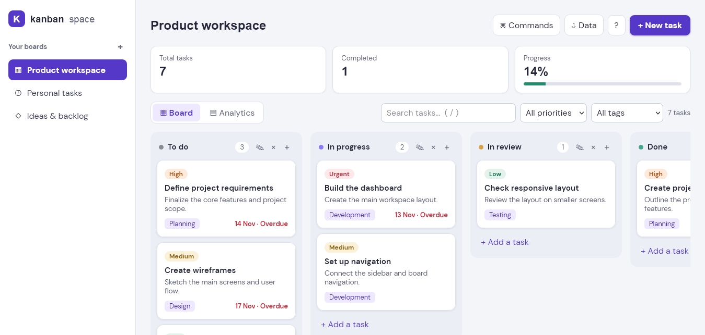
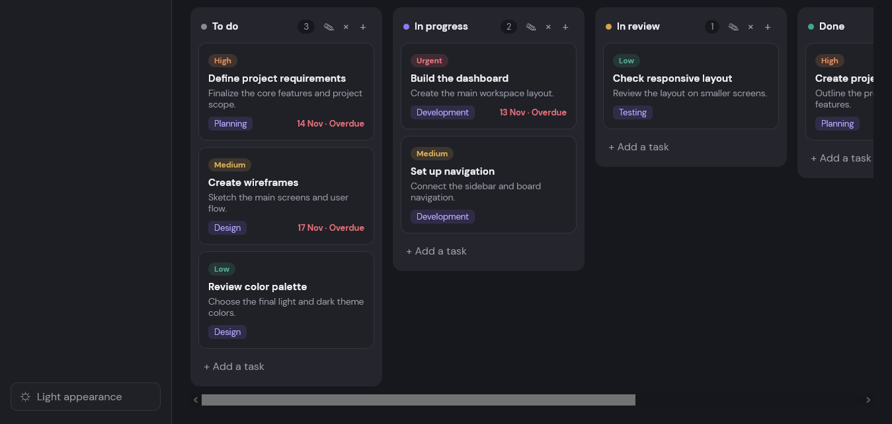
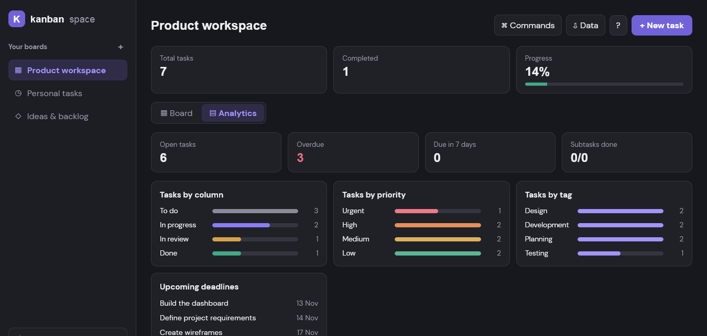
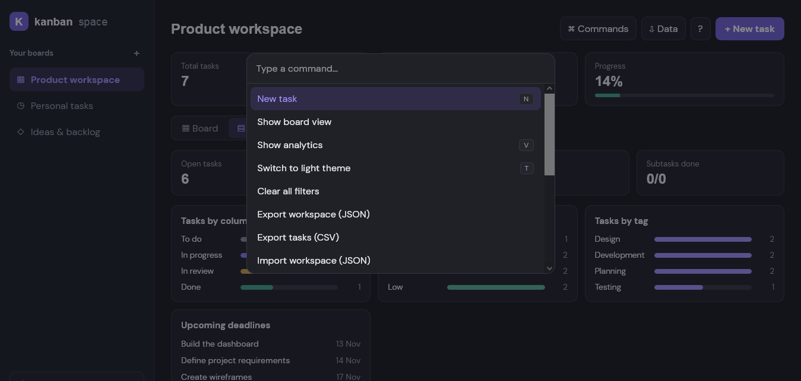

# Kanbanspace

A multi-board Kanban workspace built with React and Vite. Live demo: https://kanban-space-pi.vercel.app/






## Features
- Multiple boards with add, rename and delete columns
- Tasks with priority, tag, due date and subtasks (progress on each card)
- Drag and drop between and within columns, with a drop indicator
- Search plus priority and tag filters; overview of total, completed and progress
- Analytics view: open, overdue and due-soon counts, bar charts, upcoming deadlines
- Command palette (Ctrl+K) and keyboard shortcuts (press `?`)
- Light and dark theme driven by CSS variables
- Export to JSON and CSV; validated JSON import; data saved in localStorage

## Tech
React 19, Vite, plain CSS (no UI library, no chart library), native HTML5 drag and drop.

## Architecture
- `reducers/workspaceReducer.js`: every data change is a named action (pure, easy to test)
- `context/`: `WorkspaceContext` (saved data) and `UIContext` (view, filters, dialogs, toast)
- `hooks/`: `useDragAndDrop`, `useBoardStats`, `useKeyboardShortcuts`, `useCommands`, `useTheme`
- `utils/`: pure helpers (`stats`, `filters`, `dropPosition`, `sanitizeWorkspace`, exporters)
- `components/`: one folder per component, each with its own CSS

## Run locally
```bash
npm install
npm run dev
```
